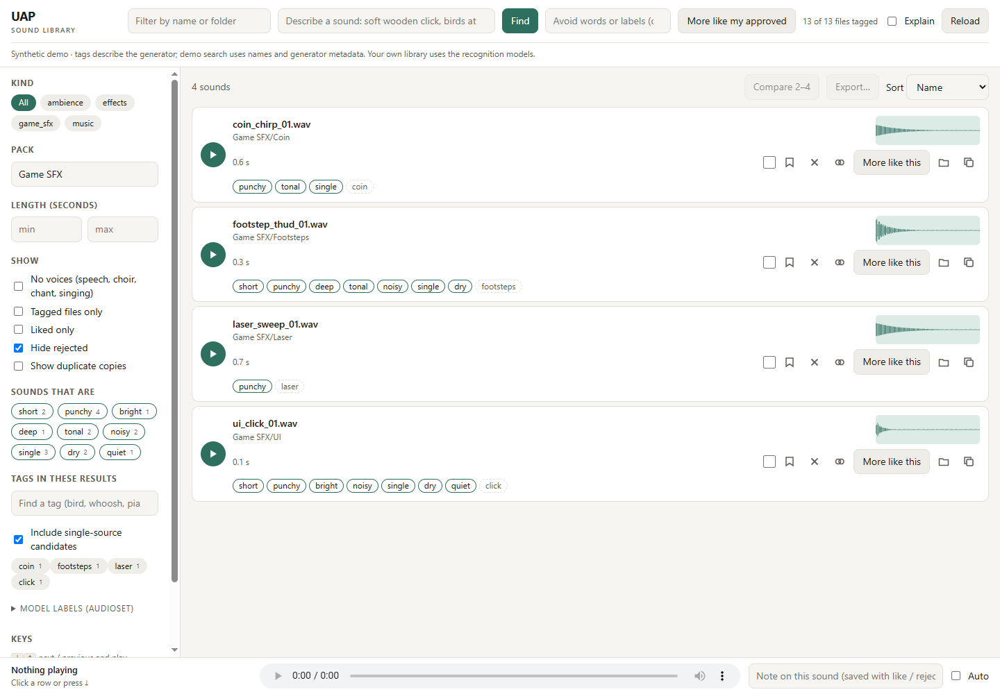
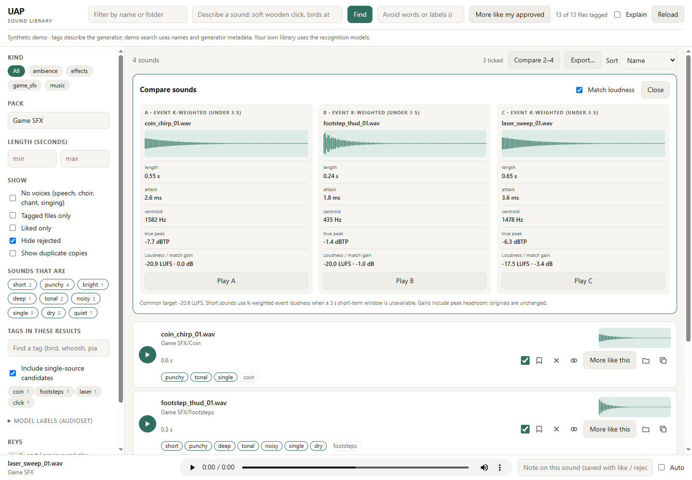
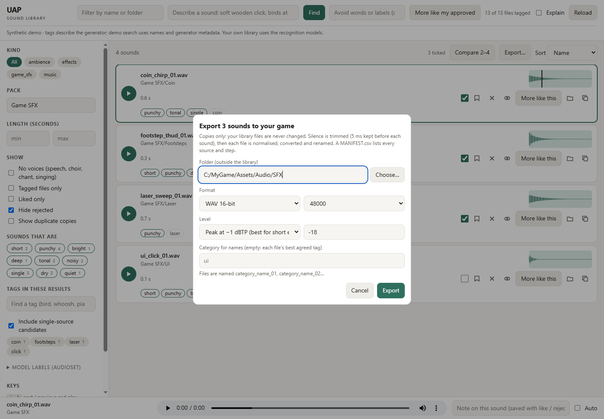
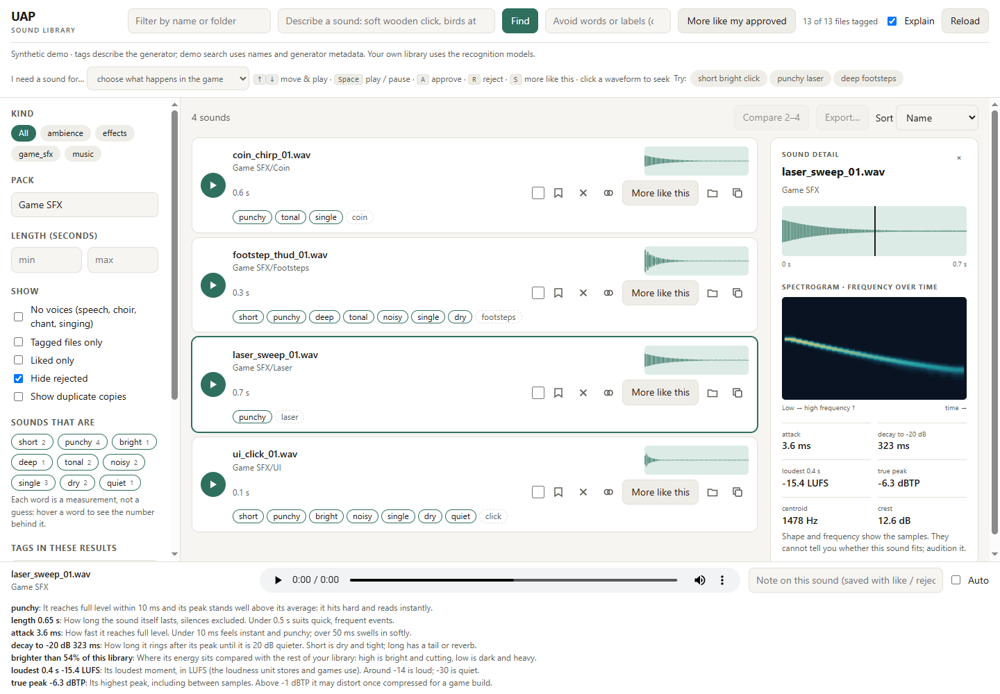
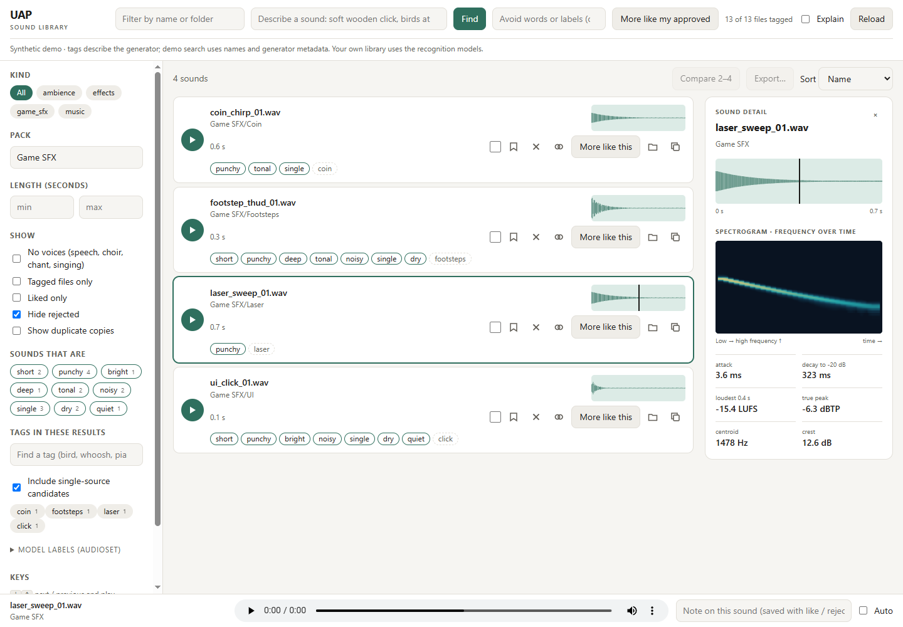

# Ultimate Audio Partner

Tag a local sound library with sound-event labels and audio fingerprints.
Measure every sound: length, loudness, attack, decay, brightness, pitch, loops.
Browse, audition, and save likes, rejects, and notes in a local web page.
Search by words ("short punchy bright click"), by an example sound, or by sounds you approved.
Spot duplicates, pick varied takes, and export trimmed, normalised files to your game.
Render a CSV cue sheet into aligned stems and a normalised final mix.
Measure that mix, then listen: no tool here listens for you.

## Try it in two minutes

After [installing the dependencies](#install), run:

~~~bash
python tools/demo.py
~~~

Or run `Tag Library.bat demo` / `Sound Browser.bat demo` on Windows,
`bash tag-library.sh demo` / `bash sound-browser.sh demo` on macOS/Linux.
The demo generates a temporary library, measures it and opens the browser.
It needs no personal sound library, model cache or model downloads. It includes
a coin chirp, laser sweep, footstep thud and UI click, plus the synthetic smoke
test sounds. Its category tags come from the generator; demo search uses names
and measured words, and similarity uses measured spectra. A banner makes this
provenance visible. A normally tagged library uses CED and CLAP.

Read [How it works](docs/how-it-works.md) for the evidence behind a result,
or the [changelog](CHANGELOG.md) for the capability history.

## Install

Clone or download [the repository](https://github.com/Youtouch/UltimateAudioPartner).
Use Python **3.12** (tested with 3.12.10); other Python versions have not been
verified with the pinned dependencies. Install FFmpeg and ffprobe together,
then open a terminal in the repository folder:

~~~bash
python -m venv .venv
# Windows PowerShell:
.venv\Scripts\Activate.ps1
# macOS / Linux:
source .venv/bin/activate
python -m pip install -r requirements.txt
ffmpeg -version
ffprobe -version
~~~

On macOS/Linux, use python3 if python is unavailable. The shell launchers use
python3; activate your virtual environment first. On Windows they use python.

CPU works. For NVIDIA acceleration, first install torch and torchaudio **2.11.0**
from the PyTorch CUDA 12.8 wheel index, then install requirements.txt. The pins
accept both the tested 2.11.0+cu128 build and portable 2.11.0 CPU wheels.

~~~bash
python -m pip install torch==2.11.0 torchaudio==2.11.0 --index-url https://download.pytorch.org/whl/cu128
python -m pip install -r requirements.txt
~~~

Search, tagging and first-time name indexing use the models; rendering and mix
checks use FFmpeg and CPU.
Measured **2026-10-12**: in the CPU-only synthetic smoke test (9 readable files of 0.2 to 90 seconds,
plus one corrupt file, two CPU threads, cached models), tagging took **14.5 s,
1.61 s/file** and measuring descriptors **7.1 s, 0.79 s/file**, both including
process and model startup. On a 35,000-file, 190-hour library, the descriptor
pass took **0.09 s/file** of wall time with 12 single-thread workers (about
0.2 s for a sub-second effect and 1.7 s for a 100 s music file, per worker).
These are examples, not speed guarantees.

FFmpeg discovery checks the FFMPEG environment variable, then the Windows
WinGet Gyan bundle on Windows, then PATH. FFMPEG must point to the executable;
ffprobe must be beside it (without .exe on macOS/Linux).

The first tag/search pass downloads models into the Hugging Face cache.
Weight sizes measured **2026-10-12**. Allow roughly **1 GB** for the default model weights, plus configuration,
tokenizer files and package dependencies. Once cached, inference runs locally.

| Model | Approximate weight download | Purpose | Licence |
|---|---:|---|---|
| mispeech/ced-base | 343 MB | 527 AudioSet labels, default tagger | Apache-2.0 |
| laion/clap-htsat-unfused | 615 MB | Audio/text fingerprints and search | Apache-2.0 |
| MIT/ast-finetuned-audioset-10-10-0.4593 | 346 MB, optional | Alternative tagger with AUDIO_TAGGER=ast | BSD-3-Clause |

See [NOTICE](NOTICE). CED uses model code pinned to a reviewed revision.
Model downloads require network access on first use; no sound files are uploaded.
For an offline machine, populate the same model cache beforehand and set
HF_HUB_OFFLINE=1 and TRANSFORMERS_OFFLINE=1.

## Tutorial: your first small library

Allow about ten minutes after installing dependencies and caching models.
Start with a folder containing 5–10 short sounds you have permission to use,
preferably under pack subfolders. Replace MySounds below with that folder.
The library must be writable: indexes and your verdicts live beside the sounds.

1. Tag the folder. On Windows, drag it onto **Tag Library.bat**.
   On macOS/Linux, run:

   ~~~bash
   bash tag-library.sh "/path/to/MySounds"
   ~~~

   The launcher tags files, indexes their names, measures every sound, builds
   the vocabulary tags and groups duplicates and variation sets.
   It remembers the absolute folder in library.txt for the next run.
   Check the final tagged / unchanged / skipped summary.

2. Open **Sound Browser.bat**, or run:

   ~~~bash
   bash sound-browser.sh "/path/to/MySounds"
   ~~~

   Keep the terminal open. The browser listens on 127.0.0.1:8790, or the next
   free port. Press Ctrl+C in the terminal to stop it.

3. Filter by pack or length, enter a description such as "rain", and press Find.
   Audition candidates with the play buttons or up/down arrows.
   Like one and reject another, then select **More like my approved**.
   The optional Avoid field accepts words or a regex such as Choir|Speech.

4. Copy [examples/cue_sheet.csv](examples/cue_sheet.csv) beside a voice recording,
   music, a bed and an effect. Replace filenames, excerpt lengths and gains.
   Render it with the command below. Inspect cue_report.md, resolve FAIL
   verdicts, and listen to final.wav. A passing measurement does not judge fit.

## For game developers: from library to game in ten minutes

No audio training needed. After the tutorial's first two steps:

1. **Find.** Type what you need, sound first, then plain words:
   `short punchy bright click`, `loopable rain`, `deep explosion`. The sound
   word ("click") is searched; the plain words are *filters on measurements*
   (below), so "short" really means under half a second: matching files come
   first, the rest follow. Not sure what to type?
   Tick **Explain**: it shows example searches from your own library and an
   **I need a sound for…** menu (a button press, picking up an item, a hit,
   a footstep, an explosion, ambience) that fills the search in for you.
2. **Audition.** Down arrow plays the next result. Hover a word chip to see the
   number behind it; with Explain on, the footer says what each number means
   for how the sound feels in a game. **A** approves, **R** rejects, and **S**
   finds more like the open sound. Click a waveform to seek.
3. **Pick variations.** A sound played often (footsteps, clicks, hits) should not
   repeat the same file. A row marked **12 takes · pick varied** belongs to a
   set of takes; ask for 4 and you get the four most different, for round-robin
   playback. The same sound saved twice (a WAV and its MP3, or one file in two
   packs) shows once, with "also in: …".
4. **Compare.** Tick two to four sounds and select **Compare 2–4**. Their
   waveforms, length, attack, brightness, true peak and loudness appear side by
   side. Play A, B, C or D through the same player. **Match loudness** is on by
   default: each file gets the same maximum three-second short-term loudness,
   with a shared target lowered to preserve peak headroom. Files under three
   seconds use explicitly labelled K-weighted event loudness instead. Silence
   has no loudness target. Toggle matching to hear the original levels.

   

5. **Export.** Tick the sounds, then **Export…**: choose a folder in
   your game project, a format (WAV 16/24-bit or OGG) and a sample rate. Each
   copy is trimmed of silence, normalised to −1 dBTP peak (or, for long files,
   a loudness target) and named `category_name_01`. MANIFEST.csv records every
   source, its pack and licence file, and each step. Your originals are never
   changed. The same from a terminal:

   ~~~bash
   python skills/audio-designer/scripts/export_sfx.py --root "/path/to/MySounds" --list picks.txt --out "/path/to/Game/Assets/Audio/SFX" --format ogg --rate 48000
   ~~~

   

## For sound designers: measures, words and thresholds

`audio_describe.py` measures every file without a model and writes
AUDIO_DESCRIPTORS.csv: duration with leading and trailing silence trimmed and
recorded, true peak (dBTP, 4× oversampled), integrated loudness (BS.1770 /
R128, blank under 400 ms), short-term and momentary maximum (LUFS), crest
factor, attack (10–90 % of the first onset), decay (peak to −20 dB), spectral
centroid, 85 % rolloff, flatness, share of energy below 150 Hz, pYIN pitch
(blank when unvoiced), onset count, a loop-seam test and clipping runs.
Definitions, library calls and known limits: [docs/descriptors.md](docs/descriptors.md).

Each plain word is one row of `WORDS` in that script, naming its measure:
`punchy` is attack ≤ 10 ms and crest ≥ 12 dB; `bright` is a centroid in the
top quarter *of this library* (a percentile, so it adapts to a library of
foley or of synths); `loud` is a momentary maximum of −14 LUFS or more.
Edit a threshold there and rerun search or the browser: no pass needs repeating.
An unmeasured file never passes a filter.

Explain mode spells out the measured words and numbers and shows the keyboard
shortcuts. The demo's category chips are dashed single-source candidates;
measured word chips still reflect the real generated samples.

## How to tag or refresh a library

~~~bash
python skills/audio-designer/scripts/audio_tag.py tag --root "/path/to/MySounds"
python skills/audio-designer/scripts/audio_search.py names --root "/path/to/MySounds"
python skills/audio-designer/scripts/audio_describe.py describe --root "/path/to/MySounds"
python skills/audio-designer/tagging/vocab_tags.py build --root "/path/to/MySounds"
python skills/audio-designer/scripts/sfx_groups.py build --root "/path/to/MySounds"
~~~

Those are the same five steps as the tag launcher. --out can select a different
tags CSV; search/browser expect the default AUDIO_TAGS.csv in the root.
The pass resumes unchanged files using size and nanosecond modification time.
Run it again after adding or changing sounds; stop and resume when needed.

Tagging also refreshes AUDIO_LEDGER_files.csv with full duration, pack, sample
rate, channels, size and modification time. Existing annotation columns and
rows are preserved. Unreadable files remain visible with unavailable metadata;
AUDIO_TAGS_skipped.csv is rewritten each pass with paths and reasons.
If the ledger is missing, readers print a note and use tag metadata: older
seconds_tagged values describe only the analysed span, not full duration.
Retagging rebuilds full-duration metadata without re-running unchanged models.

To inspect loose files without creating a library:

~~~bash
python skills/audio-designer/scripts/audio_tag.py tag clip.wav other.mp3
~~~

## How to browse and use verdicts

~~~bash
python skills/audio-designer/scripts/sound_browser.py --root "/path/to/MySounds"
~~~

Filter by name, pack, kind, length, canonical tags, or raw AudioSet labels.
Solid tags have support from multiple sources; dashed candidates have one.
Reload picks up library updates. Every readable row has a whole-file peak
envelope. Open a sound for a larger waveform, spectrogram and key measures.
Click either waveform to seek; its playhead follows playback. Envelopes are
precomputed during the descriptor pass and cached in AUDIO_VISUALS/ beside it;
the browser fills missing previews once. Size, nanosecond modification time
and cache version invalidate changed audio. Spectrograms are generated on first
open and reused. Ten-second label strips still show recognised events.
After editing audio, rerun the tag launcher to refresh descriptors and labels;
Reload refreshes previews and playback and clears old comparison gains.

**Similar audio** compares the raw fingerprints. **More like this** uses that
file as the example and your rejects as counter-examples. **More like my
approved** uses all your liked files plus rejects. Both use the editable Avoid
field; they exclude the example/rejected files themselves. Verdicts and notes
are saved to AUDIO_VERDICTS.json and available to an agent.

| Key | Action |
|---|---|
| Up / down | Previous / next file and play |
| Space | Play / pause |
| Left / right | Seek five seconds |
| A / R | Approve / reject (L / X also work) |
| S | More like this, using saved rejects and Avoid |
| M | Similar audio |
| C | Copy full path |
| Checkbox | Select for comparison or export |

## How to search by words or examples

~~~bash
python skills/audio-designer/scripts/audio_search.py find --root "/path/to/MySounds" "a soft wooden click" --top 20
python skills/audio-designer/scripts/audio_search.py like --root "/path/to/MySounds" --approved "rain approved.wav" --rejected "traffic.wav" --avoid "Speech|Music" --min-seconds 60 --top 20
~~~

The CLI's example arguments are path substrings. Use an unambiguous relative
path. --min-seconds filters on full ledger duration when present.
The browser selects saved verdict paths exactly.

## How to render a cue sheet and check a mix

~~~bash
python skills/audio-designer/render/render_mix.py render examples/cue_sheet.csv --out rendered
python skills/audio-designer/mix/mix_check.py stems --voice rendered/voice.wav --music rendered/music.wav --bed rendered/bed.wav --sfx rendered/sfx.wav --mix rendered/final.wav
~~~

Use a new or empty output directory. Paths in a CSV resolve beside that CSV.
The renderer produces voice.wav, music.wav, bed.wav, sfx.wav, final.wav,
render.json and cue_report.md. Gains, EQ and ducking are baked into the stems.
It exits 0 without checker FAILs, 2 for measured FAILs, and 1 for input errors.
Warnings still need inspection.

The commented template uses these numeric columns:

| Column | Meaning |
|---|---|
| layer, file | voice / music / bed / sfx and a local audio file |
| excerpt_start, excerpt_end | Source excerpt in seconds; defaults to the whole file |
| cue_in, cue_out | Timeline start/end in seconds; omitted end follows excerpt duration |
| gain_db | Gain applied before summing, default 0 |
| duck_ratio | Music/bed compressor ratio (e.g. 3 or 8:1); blank or - disables |
| highpass_hz, lowpass_hz | Optional filter cutoffs; blank or - disables |
| fade_in, fade_out | Fade lengths in seconds, default 0.01 / 0.02 |
| loop | yes/no, default no; music/bed repeat with a short seam crossfade |
| align | start/peak, default start; for sfx, peak places the excerpt's loudest sample at cue_in |

With align=peak, source audio before time zero is cropped. cue_out is still a
timeline end. With loop=no, a short source leaves silence for the rest of its cue.
Lines beginning with `#` may appear before the CSV header or between rows.

For exact timing, validation rules, output measurements and limitations see
[render reference](skills/audio-designer/render/README.md) and
[mix checker reference](skills/audio-designer/mix/README.md).
The checker also accepts separately edited, zero-aligned stems after gain:
measure these before final normalisation, with the final supplied separately.

## How to calibrate on your own approved mixes

Put each approved mix's aligned stems in a separate folder: voice.wav and
music.wav, optionally bed.wav and sfx.wav. These are the actual edited stems
after gain/ducking, not original source files.

~~~bash
python skills/audio-designer/mix/mix_check.py calibrate --stems approved-a approved-b --out levels.json
python skills/audio-designer/mix/mix_check.py stems --voice rendered/voice.wav --music rendered/music.wav --levels levels.json
python skills/audio-designer/render/render_mix.py render cues.csv --out calibrated-render --levels levels.json
~~~

Calibration measures the same active-voice gaps as the checker. It uses the
lowest approved gap minus a documented margin, then adds a warning tolerance.
levels.json records the measurements, policy and effective thresholds.
Without --levels, the original defaults apply unchanged.

Baked stems cannot reveal a compressor's threshold, attack or release.
Calibration therefore retains the default ducking settings in levels.json;
edit those explicit settings if your production requires different ducking.
See the mix reference for schema and units. Calibrating on a mix means you
approved it by ear: the tool cannot make that judgement.

## Reference: library files and verification

Generated indexes stay in the sound-library folder and should not be committed:

| File | Contains |
|---|---|
| AUDIO_TAGS.csv | Latest labels per path, capped timeline, tagger identity |
| AUDIO_TAGS_clap.f32 / .json | 512-number fingerprints and fingerprint settings |
| AUDIO_LEDGER_files.csv | Full-duration metadata; preserves your annotations |
| AUDIO_TAGS_skipped.csv | Last pass's skipped files and reasons |
| AUDIO_NAMES_clap.npz | Cached name vectors |
| AUDIO_VOCAB_TAGS.csv | Canonical tags with separate evidence sources |
| AUDIO_DESCRIPTORS.csv | Measured descriptors per file (no model) |
| AUDIO_VISUALS/ | Cached peak envelopes, audition loudness and spectrograms |
| AUDIO_GROUPS.csv | Duplicate sets (kept copy) and variation sets |
| AUDIO_VERDICTS.json | Your likes, rejects and notes |

Run **python tools/check_all.py before a pull request**. It runs the self-tests
and a fresh-copy, 10-file synthetic smoke test, including real cached-model
inference, browser API requests, rendering and checking. Missing dependencies
or model caches fail visibly; the tests never download or install anything.
The HTML and keyboard checks use an installed Node.js; screenshot capture also
uses an installed Microsoft Edge. Neither is needed to run the demo browser.
Maintainers with a live installed audio-designer skill test an allowlisted
staging copy by default; --published tests the repository's shipped copy.
The publisher uses this same runner and checks a local, ignored private-word
list before replacing any destination files.

~~~bash
python tools/smoke_test.py                 # 40 synthetic files, including one corrupt
python tools/smoke_test.py --quick --cpu   # 10 files; reports seconds per readable file
python tools/check_all.py --published
~~~

To regenerate the five screenshots from real synthetic demo UI output, use
`python tools/capture_demo.py` with installed Microsoft Edge and Node.js.
The script also checks Find, waveform seeking and comparison gain toggling.

## Explanation and limits

Word search combines audio fingerprints, cleaned names and model labels,
retaining each source's rank. Labels confirm candidates rather than proving
identity. A missing label does not establish the absence of a sound.
Example search uses closeness to approvals and penalises closeness to rejects.

The tagger analyses the **first 60 seconds**, in ten-second windows.
The fingerprint covers the **first 10 seconds**; short files are padded with
silence. Full-file tagging was tried and dropped after a pilot found no clear
quality gain and some worse retrieval, while adding processing and storage
cost; events later than the cap can therefore be missed.
Full-file duration is still measured for filtering. A fingerprint of an intro
does not describe a later section.

Descriptors measure samples, not meaning: "punchy" says attack and crest,
not that a sound suits a punch. Brightness words are relative to your library.

Benchmark numbers are graded by **file names** until humans review the clips.
That proxy favours name-based methods; it is not listening accuracy.
See [benchmark methods](skills/audio-designer/bench/README.md).

Measured **2026-10-11**: CED-base was adopted after **59 versus 21 paired
wins**, McNemar **p < 0.0001**, on 513 filename-sampled clips. These are
expected-family label hits, not listener judgements.

Short-effect search measured **2026-10-12**, macro AP against filename truth,
files under 1.5 s (unchanged before/after the unadopted input experiment):

| Split | Files | Name | Audio | Labels | Fused |
|---|---:|---:|---:|---:|---:|
| DEV | 11,199 | 0.506 | 0.193 | 0.050 | 0.391 |
| TEST | 4,883 | 0.364 | 0.078 | 0.009 | 0.272 |

Three queries have no TEST files and six have fewer than ten. Inspect the
per-query output before interpreting the macro score. The short-input label
experiment produced 9 new-only versus 10 old-only TEST hits (p = 1.0), so no
label-input change was adopted.

The mix gate is an energy gate, not speech recognition. It cannot establish
intelligibility, fit, biome coherence, source rights or musical taste.
No tool here listens for you. Keep measured facts, model recognition and your
judgement separate; listen before using the result.

## Licence and credits

Ultimate Audio Partner is open source under
the [Apache License 2.0](LICENSE). Model licences and attribution are listed in
[NOTICE](NOTICE). No sounds, private library data or approved production mixes
are distributed. FFmpeg, PyTorch, Transformers and the other dependencies
retain their own licences. AudioSet recognition uses CED-base (or optional AST);
text/audio matching uses LAION CLAP.

