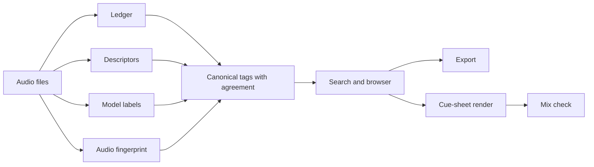

# How it works

UAP keeps measured properties, model predictions and listening decisions separate. A result explains which evidence supports it; a tag or a passing mix check does not replace an audition.

**Audio files.** Decoding reads WAV, MP3 and other formats supported by the installed FFmpeg. Originals are read; derived tables, caches and verdicts are written beside the library. An unreadable file is recorded with a reason. A file name and folder can suggest a source, but cannot establish what is audible or whether the recording is licensed for a particular use.

**Ledger.** `AUDIO_LEDGER_files.csv` records full-file duration, channels, pack, relative path, size and modification time. Those last two values let subsequent passes reuse unchanged work while preserving existing ledger fields. Metadata describes the file container and decoded duration; it cannot establish source identity, fidelity or suitability, and size/time checks do not detect a deliberately changed file whose metadata is preserved.

**Descriptors.** `AUDIO_DESCRIPTORS.csv` measures trimmed length and surrounding silence, attack and decay, loudness, true peak, crest, spectral brightness, pitch, onsets, clipping and loop seam. Words such as “short”, “bright” and “punchy” map to explicit measurement rules. Pitch estimation assumes a dominant pitch and often returns no answer for chords or noisy effects; an energy threshold cannot distinguish intentional silence from a quiet event. A plausible seam measurement does not guarantee an inaudible loop.

**Model labels.** CED-base predicts AudioSet events in ten-second windows over the opening analysis span, normally up to sixty seconds. Stored scores and the tagger name preserve the model's reading. Labels are neither calibrated truth nor an exhaustive event inventory: a missing label is not evidence of absence, later events can be outside the span, and designed effects can be misclassified.

**Audio fingerprint.** CLAP maps the opening ten seconds to a unit-length vector that can be compared with text or another sound. Short sounds are padded with silence. Similarity orders candidates; it does not prove an audible match, identity or taste, and it can miss changes later in a long recording. Duplicate groups additionally require waveform correlation; variation groups suggest different takes for a listener to assess.

**Canonical tags with agreement.** A controlled vocabulary combines cleaned names, mapped model labels and audio similarity. Two supporting sources yield an agreed tag; one source remains a candidate. Frozen per-tag label rules are fitted on DEV packs and evaluated separately on TEST. Agreement measures consistency between correlated evidence sources, not independent confirmation or listener-reviewed accuracy; disagreement is a useful reason to listen.

**Search and browser.** Text search merges separate audio, name and label ranks; files matching measured descriptive words come first. Example search uses approved sounds and rejected counter-examples. The browser shows evidence, measurements and cached visual previews, and stores human verdicts in `AUDIO_VERDICTS.json`. A waveform shows level over time and a spectrogram shows energy across frequency; neither can identify a sound or decide whether it fits a scene.

**Export.** Selected sounds are copied to a separate destination with silence trimming, a short pre-roll, peak or eligible-file loudness adjustment, format conversion and clean names. `MANIFEST.csv` records sources, found licence files, processing steps and descriptors. A found licence file is provenance, not a legal determination. Export settings are starting points that still need auditioning in the target engine.

**Cue-sheet render.** A CSV specifies each source excerpt, cue time, gain, filters, fades, looping and ducking. The renderer produces aligned stems and a loudness-normalised final WAV, then invokes the mix checker. Crossfades can soften repetition and peak alignment can place a transient; neither chooses musical timing, performance or artistic balance for you.

**Mix check.** The checker measures stem and master loudness, true peak, balance and speech-window overlap against explicit thresholds, optionally calibrated from approved mixes. Its speech windows use an energy gate rather than a speech recogniser. A PASS means the measured checks passed; it cannot establish intelligibility, masking at every frequency, emotional impact or listening comfort. Final judgement belongs to the listener.
